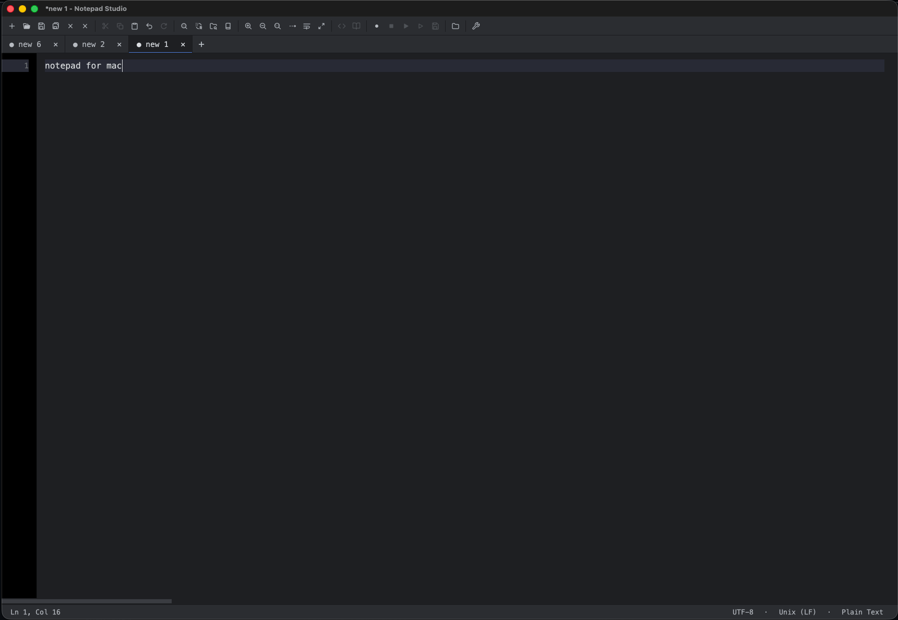

# Notepad Studio

A lightweight, cross-platform text editor inspired by Notepad++, written in Rust. Notepad++ feel, AI features optional, no bloat.



> **Status:** v0.0.5. The core editor and Beyond section have shipped. Word wrap
> + horizontal scrollbar, show whitespace, full-screen (F11), bracket matching,
> auto-indent, syntax-aware comment toggle (24 langs), drop-to-open, recent
> files, tab drag-reorder, per-window placement persistence, multi-click
> selection (word/line/all), per-buffer EOL + encoding toggles, Replace All
> single-undo, user-customisable Shortcut Mapper, in-window right-click context
> menu, column/multi-cursor edit, macro record / replay, plugin host, session
> restore, and large-file streaming reads have all landed. Currently in flight:
> Notepad++ behavior parity and correctness audit, including remaining
> completion and IME edge cases, focus bugs, and menu gaps.

Optional [API completion definitions](docs/api-completion.md) supply language
names for Function Completion and signatures for parameter hints, including
the active argument and overload navigation.

## Goals

- **Lightweight** — small binary, fast cold start, low memory.
- **Cross-platform** — macOS, Linux, Windows.
- **Familiar** — Notepad++-style UX: tabs, find/replace, encoding/EOL toggles,
  syntax highlighting, plugin-friendly.
- **Open source** — Apache-2.0.

## Built with

- [`gpui`](https://gpui.rs/) — the GPU-accelerated UI framework from Zed Industries
  (Apache-2.0). Notepad Studio uses gpui as a UI library; all editor logic, layout,
  buffer handling, file I/O, and UX are original to this project.
- [`ropey`](https://crates.io/crates/ropey) — rope data structure for the text buffer.
- [`rfd`](https://crates.io/crates/rfd) — native file dialogs.
- [`regex`](https://crates.io/crates/regex) — find/replace engine (literal escape, whole-word `\b`, and full regex modes).
- [`dirs`](https://crates.io/crates/dirs) — platform-correct config / log paths.
- [`serde`](https://crates.io/crates/serde) + [`toml`](https://crates.io/crates/toml) — settings persistence.

## Platform support

| Platform | Status         | Notes |
| -------- | -------------- | ----- |
| macOS    | tested daily   | Native menu bar, dock-icon reopen, traffic-light position. Default line ending: LF. |
| Linux    | builds         | X11 / Wayland via gpui's defaults. Default line ending: LF. Last-window-close exits the app. |
| Windows  | builds         | Default line ending: CRLF. Last-window-close exits the app. `File ▸ Exit` and `Alt+F4` both work. |

Keybindings register Cmd-* and Ctrl-* variants together so the same source builds
across all three platforms — only the active modifier fires per OS. Word-jump
also accepts `Alt-arrow` (macOS convention) alongside `Ctrl-arrow` (Notepad++).
Crash reports land in `~/Library/Logs/Notepad Studio/panic.log` (macOS),
`$XDG_STATE_HOME/Notepad Studio/panic.log` (Linux), or
`%LOCALAPPDATA%\Notepad Studio\Logs\panic.log` (Windows).

## Installing a release

Download a prebuilt binary from the
[Releases page](https://github.com/alesloa/notepad-studio/releases). Each release
ships one artifact per platform:

| Platform | Artifact | Contents |
| -------- | -------- | -------- |
| macOS (Apple Silicon) | `Notepad-Studio-macos-arm64.zip`   | `Notepad Studio.app` |
| macOS (Intel)         | `Notepad-Studio-macos-x86_64.zip`  | `Notepad Studio.app` |
| Linux x86_64          | `Notepad-Studio-linux-x86_64.tar.gz` | `notepad-studio` binary |
| Windows x86_64        | `Notepad-Studio-windows-x86_64.zip`  | `notepad-studio.exe` |

All assets (icons, themes) are embedded in the binary, so the Linux and Windows
artifacts are just the standalone executable — no extra files to keep alongside it.

> **macOS Gatekeeper note:** the `.app` is **not signed or notarized yet**, so the
> first launch is blocked by Gatekeeper. Either **right-click the app → Open** (then
> confirm once), or clear the quarantine flag after moving it to `/Applications`:
>
> ```sh
> xattr -dr com.apple.quarantine "/Applications/Notepad Studio.app"
> ```

## Build & run

```sh
cargo build            # debug build
cargo run              # build + run (debug)
cargo build --release  # optimised build
cargo run --release    # build + run (optimised)
cargo check            # type-check only, no binary
```

`gpui` is vendored in-repo under [`vendor/gpui`](vendor/gpui), so the project is
fully self-contained — nothing is fetched or downloaded for it. The first build
compiles the vendored `gpui` from source (a few minutes); subsequent builds are
fast.

Release builds (`cargo bundle`) carry the app icon automatically. Regenerating
icons from new source art → [`docs/icons.md`](docs/icons.md).

## Roadmap

### v0.0.1 — scaffold ✅
- [x] Window opens, native menu bar, dark theme, status bar
- [x] Stubbed actions (File / Edit / View / Help)
- [x] Rope-backed read-only buffer renders line-by-line with gutter

### v0.0.2 — selection & themes ✅
- [x] Custom `EditorElement` with shaped lines and selection paint
- [x] Click + drag to select; shift-click to extend selection
- [x] `Cmd/Ctrl-A` select all, `Cmd/Ctrl-C` copy via system clipboard
- [x] `FocusHandle`, key context, IBeam cursor over the editor
- [x] Light + Dark theme with `View ▸ Toggle Theme` (`Cmd/Ctrl-Shift-T`)

### v0.0.3 — editable buffer ✅
- [x] `EntityInputHandler` — OS / IME text routes into the rope buffer
- [x] Backspace, Delete, Enter, Tab (4 spaces, configurable)
- [x] Arrow keys, Home/End, Cmd+Home/End, Cmd+Up/Down for doc bounds
- [x] Alt+Left/Right and Ctrl+Left/Right for word boundaries
- [x] Shift-extend variants on every movement
- [x] Sticky desired column for vertical movement
- [x] Caret blinks every 500ms via `gpui::Timer` task; resets on activity
- [x] Cut (Cmd+X), Paste (Cmd+V) wired to system clipboard
- [x] Linear undo / redo stacks (Cmd+Z, Cmd+Shift+Z, Ctrl+Y)
- [x] Dirty bit reflected in the title bar (● prefix)

### v0.0.3 — cross-platform polish ✅
- [x] Mouse drag keeps selecting when the cursor leaves the window
- [x] `File ▸ New Window` (Cmd/Ctrl+Shift+N) and macOS dock-icon reopen
- [x] Ctrl- variants for every Cmd- chord; Linux/Windows-friendly defaults
- [x] `QuitMode::Default` — macOS stays alive on last window close, Linux/Windows exit
- [x] `File ▸ Exit` menu entry alongside the macOS `Quit`
- [x] OS-aware line endings — CRLF default on Windows, LF elsewhere
- [x] Panic hook writes timestamped reports to a platform-correct log dir
- [x] Window placement persisted to `<config>/Notepad Studio/window.toml`

### v0.0.4 — file I/O & tabs ✅
- [x] Multi-tab buffers — switchable buffers in one window with a top tab strip
- [x] `Cmd/Ctrl-N` opens a new empty tab; `Cmd/Ctrl-W` closes the active tab
- [x] `Ctrl-Tab` / `Ctrl-Shift-Tab` cycle tabs (MRU order, MRU tracking deferred)
- [x] `Ctrl-PageDown` / `Ctrl-PageUp` cycle tabs in visual order
- [x] `Cmd/Ctrl-1`..`Cmd/Ctrl-9` jump directly to tab N
- [x] `Cmd/Ctrl-Shift-W` closes every tab; one fresh blank tab is left behind
- [x] `Cmd/Ctrl-Shift-T` restores the most recently closed tab (last 20)
- [x] Closing the last tab in a window closes the window
- [x] Theme toggle moved to menu only (free for Notepad++ parity)
- [x] File ▸ Open via `rfd` — loads into the active empty tab or a new tab, detects LF / CRLF / CR
- [x] File ▸ Save (`Cmd/Ctrl-S`) and Save As (`Cmd-Shift-S` mac, `Ctrl-Alt-S` Linux/Win)
- [x] File ▸ Save All (`Cmd-Opt-S` mac, `Ctrl-Shift-S` Linux/Win)
- [x] Dirty-prompt on close-tab and Close All — Save / Don't Save / Cancel
- [x] Window title and tab strip sync to active tab's file path and dirty bit
- [x] Drop-to-open: drag a file onto the window (opens a new tab)
- [x] File ▸ Recent Files (persistent MRU, capped at 10, `<config>/Notepad Studio/recent.toml`)
- [x] Per-window placement persistence (replaces the v0.0.3 single-slot file)
- [x] Tab drag-reorder
- [x] View ▸ Tab — numbered/first/last/next/previous selection, reordering and colors; rebindable commands

### v0.0.5 — Notepad++ basics ✅
- [x] Find bar with incremental search (`Cmd/Ctrl-F`)
- [x] Find Next / Find Previous (`F3` / `Shift+F3`, also `Enter` / `Shift+Enter` in the find input)
- [x] Match-case, whole-word, and regex toggles (powered by `regex::RegexBuilder`)
- [x] Match counter chip — "X of Y" / "No matches" / "Invalid regex"
- [x] All-match highlighting in the editor; current match gets a stronger tint
- [x] Replace bar with Replace / Replace All (`Ctrl-H`, or `Cmd-Opt-F` on macOS)
- [x] Go to Line (`Ctrl-G`, or `Cmd-L` on macOS to leave `Cmd-G` free for Find Next convention)
- [x] Find in Files (`Cmd/Ctrl+Shift+F`) — `walkdir`-backed traversal, async
      off-main search, scrollable results panel, click-to-jump into the file
- [x] "Extended" search mode — `\n` `\r` `\t` `\0` `\b` `\\` `\xHH` `\dDDD` `\oOOO` escape interpretation in non-regex find/replace (Find / Replace / FIF / Mark)
- [x] Mark / Bookmark — `F2` toggle, `Ctrl+F2` next, `Shift+F2` previous, `Cmd/Ctrl+Shift+F2` clear all; gutter glyph + buffer-local set
- [x] Replace All as a single undo step (edit-group primitive)
- [x] Line endings toggle (CRLF / LF / CR) — click the EOL chip in the status bar to cycle
- [x] Encoding toggle (UTF-8 / UTF-8 BOM / UTF-16 LE/BE / Latin-1) — BOM-aware load, click the encoding chip to cycle

### v0.0.6 — viewing comfort
- [x] Scrollable vertical viewport — only visible lines shape & paint
- [x] Vertical scrollbar — drag thumb to scroll, click track to page-step
- [x] Mouse wheel / trackpad scroll (pixel and line-mode deltas)
- [x] PageUp / PageDown nav (with Shift- variants for selection)
- [x] Cursor auto-scrolls into view on every move (typing, arrows, find, goto, …)
- [x] Drag-select past the viewport edge auto-scrolls
- [x] Async file / message dialogs — fixes a hard crash on dirty-tab close
      (sync rfd dialogs ran the AppKit run loop and re-entered the gpui
      `AppCell` borrow held by the outer `entity.update`, panicking on the
      next caret-blink tick). Open / Save / Save As / Close-prompt all use
      `rfd::AsyncFileDialog` / `AsyncMessageDialog` driven through
      `cx.spawn_in`.
- [x] Word wrap toggle — `View ▸ Word Wrap`; visual-row layout pass with wrap cache
- [x] Horizontal scrollbar (visible when wrap is off)
- [x] Right-click context menu — in-window overlay layer; Undo/Redo, Cut/Copy/Paste/Delete, Select All, Toggle Bookmark, Go to Line, Find
- [x] Show whitespace — `View ▸ Show Whitespace` (· for spaces, → for tabs)
- [x] Zoom in/out — `Cmd/Ctrl +/-/0` (VS Code style; scales chrome, gutter, and editor; persisted via `<config>/Notepad Studio/window.toml`)
- [x] Full-screen toggle (`F11`)

### v0.0.7 — Edit ops (Notepad++ parity)
- [x] Duplicate Line / Selection — `Cmd/Ctrl+D`
- [x] Move Line Up / Down — `Ctrl+Shift+Up/Down` (Linux/Win), `Alt+Shift+Up/Down` (mac)
- [x] Delete Line — `Cmd/Ctrl+Shift+L`
- [x] UPPERCASE — `Cmd/Ctrl+Shift+U`
- [x] lowercase — `Cmd/Ctrl+U`
- [x] Toggle Block Comment — `Cmd+/` (mac), `Ctrl+Q` (Linux/Win)
- [x] Toggle Stream Comment — `Cmd+Shift+/` (mac), `Ctrl+Shift+Q` (Linux/Win)
- [x] Insert Blank Line Above / Below — `Cmd/Ctrl+Alt+Enter` / `Cmd/Ctrl+Shift+Enter`
- [x] Trim Trailing Whitespace — Edit menu only
- [x] Syntax-aware comment chars — per-language tokens for all 24 grammars
- [x] Replace All as a single undo step (edit-group primitive)

### v0.1.0 — syntax & language ✅
- [x] Tree-sitter syntax highlighting — Rust, Python, C, C#, JS/TS/TSX, JSON, Markdown, Bash/Sh/Zsh/Ksh, PowerShell, Go, Java, Swift, Ruby, PHP, C++, Lua, HTML, CSS, SCSS, YAML, TOML, XML, SQL (25 modes). Filename detection (Rakefile, Gemfile) and shebang fallback. Kotlin and Dockerfile not yet supported (grammar incompatibilities).
- [x] Language menu — select any of the 25 installed syntax modes or None (Normal Text), with per-tab checkmarks, session persistence and rebindable actions. Highlighting runs in the background.
- [x] Bracket matching — depth-aware pair lookup, skips brackets inside strings/comments via tree-sitter span filter; falls back to dumb scan when no language
- [x] Auto-indent — Enter inherits leading whitespace; extra indent after `{`, `[`, `(`
- [x] Comment toggle (syntax-aware) — per-language tokens for all 24 grammars (HTML/XML/Markdown wrap line ranges in `<!-- -->`; JSON no-op)

### Settings ✅
- [x] Shortcut Mapper — `Settings ▸ Shortcut Mapper`; rebind any action, conflict detection, persisted to `<config>/Notepad Studio/shortcuts.toml`

### Polish ✅
- [x] Multi-click selection — double-click a word, triple-click a line, quad+-click select-all
- [x] Drop-to-open — drag any file onto the window to open it as a new tab
- [x] Notepad++-style icon toolbar above the tab strip — File / Edit / Search / View / Macro / Plugins groups, monochrome SVGs tinted from the active theme, hover + pressed states, disabled state for unavailable actions

### Beyond
- [x] Run dialog — `F5` or `Run ▸ Run...`; Browse, document/app variables, literal argument launching and recent commands in `run.toml`. Save named commands to the Run menu; select them in the dialog to edit, rename, copy or delete. Command and name fields have their own undo/redo. Named-command keyboard shortcuts remain open.
- [x] Column-mode selection + multi-edit — alt-drag a rectangle, virtual columns extend past EOL, typing/Backspace/Delete/Cut/Copy/Paste all operate rectangularly in a single undo step, sentinel-tagged clipboard so Notepad Studio→Notepad Studio block paste lands as column paste; `Cmd/Ctrl+Alt+Shift+Arrow` extends the block by keyboard. Word-wrap + block paint together, and the Column Editor numeric-series dialog, deferred
- [x] Macro record / replay — `Cmd/Ctrl+Shift+R` toggle recording, `Cmd/Ctrl+Shift+P` playback, `Cmd/Ctrl+Shift+M` opens an inline "Run N times" prompt; Save Currently Recorded prompts for a name, persists to `<config>/Notepad Studio/macros.toml`, and the saved entries appear under the `Macro` menu for one-click replay
- [x] Plugin host — native cdylib plugins drop into `<config>/Notepad Studio/plugins/` and load at startup via `libloading`; the [`notepad-studio-plugin`](crates/notepad-studio-plugin) crate defines the C-ABI (`PluginInfo` / `HostApi`) and ships a safe `Plugin` trait + `declare_plugin!` macro for authors. The Plugins menu lists every loaded plugin with one submenu per plugin and one menu item per command. See the [Plugins](#plugins) section below
- [x] Large-file streaming reads — files >10 MB stream in 1 MB chunks on the bg executor with status-bar progress + Cancel; >2 GB shows a confirm-open dialog; syntax highlighting skipped above 50 MB
- [x] Session restore — open tabs, scroll positions, selections, and per-window placement persist across restarts; saved on autosave tick, on window close, and on app quit (`0cd4008` `8b6327b` `d8ba325`)

## Plugins

Notepad Studio loads native cdylib plugins from the editor's per-user plugins
directory:

| Platform | Path |
| -------- | ---- |
| macOS    | `~/Library/Application Support/Notepad Studio/plugins/` |
| Linux    | `$XDG_CONFIG_HOME/Notepad Studio/plugins/` (defaults to `~/.config/Notepad Studio/plugins/`) |
| Windows  | `%APPDATA%\Notepad Studio\plugins\` |

The directory is auto-created on first launch. To install a plugin, drop
its `.dylib` (mac) / `.so` (linux) / `.dll` (windows) in there and restart
Notepad Studio. The Plugins menu shows one submenu per loaded plugin with each
exposed command as a menu item; "Plugins ▸ Open Plugins Folder" reveals
the directory in the OS file manager.

A sample plugin (Uppercase Selection + Show Hello) lives under
[`crates/sample-uppercase-plugin`](crates/sample-uppercase-plugin) — build
with `cargo build -p sample-uppercase-plugin --release` and copy
`target/release/libsample_uppercase_plugin.{dylib,so,dll}` into the
plugins directory.

The plugin ABI is defined by the [`notepad-studio-plugin`](crates/notepad-studio-plugin)
crate. v1 exposes buffer read/write, selection read/write, and a status
bar message. ABI is versioned (`PLUGIN_API_VERSION = 1`); plugins built
against a different version are skipped at load time with a stderr log.

> **Trust:** plugins run as native code with full process privileges. A
> hostile plugin can read every file the editor can read and execute any
> code your user account can. Only install plugins you trust. A capability
> sandbox (wasmtime) is on the v2 roadmap.

## License

Apache-2.0 — see [LICENSE](LICENSE).
